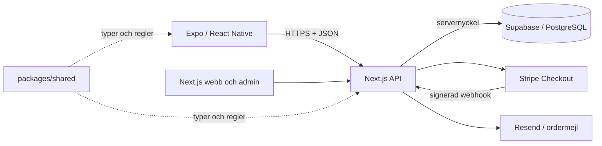

# Arkitektur

V3 lägger till Expo kring V2:s server. Vi har en databas och ett ordersystem för alla plattformar.

## Tre koddelar

**`apps/mobile`** är TypeScript 6.0.3 och React Native med Expo SDK 58, React 19.3 och Expo Router. Router kopplar filer i `app/` till skärmar. React Native ger mobilvyer. Expo sköter native-moduler, utveckling, export och byggkonfiguration. React Native Web gör även en webbförhandsvisning möjlig. Webbens verktyg använder TypeScript 5.9.3 separat.

**`apps/web`** är den bevarade Next.js 16-webben med React 19.2. Den renderar publika SEO-sidor och skyddad admin. API-rutter i samma app hanterar databas, inloggning, order, media, mejl och Stripe. Webben behöver därför en servermiljö; en statisk Expo-export ersätter inte backend.

**`packages/shared`** innehåller typer, vanliga funktioner och Zod-scheman. Det importerar varken React, databasanslutningar eller hemligheter. UI kan visa ett pris med samma regel som servern; servern hämtar ändå priserna från databasen på nytt.

V2:s kategorier, portionshjälp, menykatalog och admin för styckrätter är kvar. Uppgraderingen använder samma rätt-id:n och en SQL-kompatibilitetsvy för gamla kolumnnamn. Gamla ordersnapshots och JSON-inställningar följer med till V3:s normaliserade struktur enligt [DATABAS.md](DATABAS.md). Ingen parallell separat V2-databas behövs.

## En förfrågan från början till slut

1. Mobilen läser `/api/catalog`: aktiva paket, maträtter, aktuella kampanjer, publika företagsinställningar och leveranszoner.
2. Kunden väljer ett paket **eller** egna maträtter. Delade prisfunktioner visar styckpris, radpris och total i heltalsöre.
3. `/api/orders` validerar formuläret, datum, leverans, betalningsval och spamgräns. En databasfunktion hämtar aktuella priser och sparar ordern med dess rader atomärt.
4. Kunden får en privat orderreferens och ägaren får mejl. Ordern är fortfarande obetald.
5. Ägaren godkänner i `/admin`. Onlinebetalning får då en Stripe Checkout-länk. Kontanter hanteras vid hämtning.
6. Kunden följer status med orderkod och hemlig token. Bara verifierad Stripe-webhook får bekräfta onlinebetalning.

Mobilen sparar högst 20 orderreferenser med Expo SecureStore på Android/iOS. Expo Web använder `sessionStorage`. Referensen är en privat åtkomstnyckel; appen gör ingen publik sökning på namn eller e-post. Kunden kan också behålla mejlets privata länk.

## Betalningsvalet

V3 öppnar **Stripe-hostad Checkout** i enhetens vanliga webbläsare via React Native `Linking`. Betallänken måste använda HTTPS på `checkout.stripe.com`. Samma flöde används i Expo Go och development builds utan native PaymentSheet. Vanliga kontakt- och policylänkar använder `expo-web-browser`.

Swish stöds av Checkout för SEK när Stripe-kontot och betalmetoden är konfigurerade. Börja med sandbox/testnycklar och `STRIPE_SWISH_ENABLED=false` tills flödet verifierats. Kontots faktiska förutsättningar avgör tillgängligheten. Se [Stripes Swish-guide för Checkout](https://docs.stripe.com/payments/swish/accept-a-payment?payment-ui=checkout).

Apple Pay är en plånbok i kort-Checkout och visas bara när enhet, webbläsare, kort och konto är kompatibla. Ett val i formuläret garanterar inte att plånboken visas. Native Apple Pay skulle kräva en egen build, Merchant ID och rätt certifikat; Expo Go räcker inte för den integrationen.

Återkomsten från Checkout visar status men är inget betalningsbevis. Servern verifierar webhooksignaturen och matchar händelsen mot rätt order/session. Dubbletter hanteras med händelse-id i databasen. Kontantorder blir betald först när ägaren registrerar mottagna pengar.

En öppen Checkout-session återanvänds när ägaren skickar betalningslänken igen. En ny skapas först när föregående session verifierats som utgången. Databasfunktionen `attach_catering_checkout` kontrollerar tidigare status, betalningsstatus och session innan länken kopplas till ordern. En samtidig webhook kan därmed inte skrivas tillbaka från betald till väntande.

## Bibliotekens ansvar

| Bibliotek | Varför |
| --- | --- |
| TypeScript | Synliga typer i både app och server |
| Zod | Kontrollerar indata även när någon kringgår UI:t |
| Expo Router / React Native | Skärmar, navigation och mobilvyer |
| Expo SecureStore / WebBrowser / Video | Orderreferenser, externa informationslänkar och ljudlös video |
| Next.js / React | Befintlig webb, admin och API |
| Supabase JS / SSR | Serveråtkomst till PostgreSQL och verifierad adminsession |
| Stripe | Checkout, återbetalning och signerade betalningshändelser |
| Resend | Mejl till kunden och ägaren |
| QRCode | SVG-koder till beställning och officiell Google-recensionslänk |
| Tailwind / Lucide | Befintlig webbstyling och ikoner |

CSS sköter webbens design; mobilens färger och små gemensamma UI-delar ligger i `lib/ui.tsx`. Korta skärmfiler och tre delade ämnesfiler håller strukturen begriplig.

## Säkerhetsgränsen

Mobilen känner bara API-adressen och publik appkonfiguration. Servern kontrollerar behörighet på varje adminanrop. Databasen har RLS och inga publika orderpolicies. Produktionsappar kräver HTTPS. Demo stänger order när tjänsten inte är konfigurerad.

SEO, sitemap, strukturerad data, Google Maps och QR-koder finns på webben. Riktiga Google-länkar kommer från företagsinställningarna. Ranking eller recensioner genereras inte av systemet.

Mejl är basen för ägarnotiser. Servern har frivilligt Expo-pushstöd och admin kan manuellt registrera en befintlig token. Kundappen innehåller ännu ingen automatisk pushregistrering eller ägarinloggning. En fungerande ägarenhet kräver därför ytterligare enhetsintegration, FCM/APNs-konfiguration och verkliga tester. `OWNER_PUSH_ENABLED=false` är grundläget.
