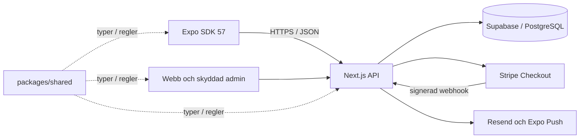

# Arkitektur i V4

Vi behåller en databas och ett ordersystem för Expo, webb och admin. V4 förbättrar befintlig kod i stället för att lägga till separata system.

## Läs koden i den här ordningen

1. `apps/mobile/app/index.tsx` visar startsidan. `app/menyer.tsx` och `app/bygg.tsx` väljer maten.
2. `apps/mobile/lib/store.tsx` håller katalog, menyutkast och privata orderreferenser i en React Context.
3. `packages/shared` ger typer, validering, öresberäkning, datum, zonval och statusregler utan React eller databasnycklar.
4. `apps/mobile/lib/api.ts` skickar formuläret till samma `apps/web/src/app/api/orders/route.ts` som webben använder.
5. API:t validerar igen och låter PostgreSQL skapa order och rader atomärt från aktuella databaspriser.
6. Ägaren hanterar ordern i webbens admin. Kunden följer den via privat kod och token.

[Filguiden](FIL_FOR_FIL.md) förklarar filernas ansvar och var du ändrar dem.

## Appar och delad kod

| Del | Ansvar |
| --- | --- |
| `apps/mobile` | Sex kundskärmar och tre stödfiler; Expo SDK 57, React Native 0.86.3 och React 19.2.3 |
| `apps/web` | Next.js16.4.2: responsiv webb, SEO, admin, API, serveråtkomst och betalningar |
| `packages/shared/types` | Samma katalog-, order-, förslags- och betalningstyper överallt |
| `packages/shared/pricing` | Rena funktioner för priser, datum, leveranszoner och tillåtna statusbyten |
| `packages/shared/validation` | Zod kontrollerar indata även när någon kringgår gränssnittet |
| `supabase/migrations` | Additiva SQL-ändringar, transaktioner, historiska priser och behörigheter |

Frontend visar en uppskattning med samma regler som servern. Servern läser alltid priserna på nytt. Pris per person är en jämförelse och delar inte upp betalningen.

## Förfrågan och ändringsförslag

Kunden väljer mat → datum/plats → kontakt/kontroll → skickar förfrågan. Menyval sparas utan kontaktuppgifter. Ett stabilt `request_id` och databaskontroll hindrar dubbla order vid dubbeltryck/återförsök.

Ägaren granskar och godkänner före betalning. Ett prisförslag sparas separat med förklaring, revisionsnummer och total. Kunden måste uttryckligen acceptera rätt revision via sin privata token. Det ursprungliga priset och orderraderna finns kvar för spårbarhet; en godkänd justering redovisas separat.

Order- och betalningsstatus är olika fält. Bara signerad Stripe-webhook kan markera onlinebetalning betald. Kontanter gäller hämtning och registreras manuellt av ägaren. Läs [BETALNINGAR.md](BETALNINGAR.md).

## Notifieringar och privata data

Resend skickar order- och statusmejl när tjänsten är konfigurerad. Expo Push används för registrerade enheter. Kundens tokenregistrering skyddas av orderns privata åtkomsttoken; ägarens registrering kräver verifierad adminsession. Native registrering finns i appen men fjärrpush fungerar inte i Expo Go. FCM/APNs och faktisk leverans måste provas i företagets miljö.

Mobilen sparar högst 20 privata orderreferenser i SecureStore på iOS/Android; Expo Web använder sessionStorage. Webbens privata status kräver samma kod/token. Länken är en behörighetsnyckel och ska inte skickas till analysverktyg.

API:t kontrollerar admin med Supabase `getUser`, bekräftad e-post och serverns allowlist. Inga service-role-, Stripe- eller mejlnycklar finns i appen. RLS och indragna publika rättigheter skyddar databasen. CORS tillåter bara angivna webborigins.

## Publicering

GitHub-källan är en monorepo. Sites har ett separat bevarat Worker/Vinext-bygglager: webbens `src`/`public` flyttas till roten där och samma shared/API används. Sites-identitet och inställningar bevaras. Expo byggs i det befintliga EAS-projektet. Ingen publicering aktiverar automatiskt riktiga order, betalningar eller databasändringar.

V2:s katalog-ID:n och orderdata bevaras genom migrationskedjan. Gamla filguider/acceptansdokument är historik. [DATABAS.md](DATABAS.md), [TESTER.md](TESTER.md) och [EXPO.md](EXPO.md) visar detaljer och verifieringsgränser.
