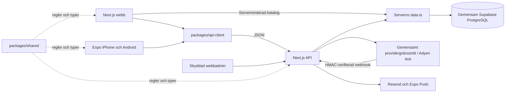

# Arkitektur i V4.3

Yehabibi har en logisk backend: Next.js-servern. Webb, Expo och den gemensamma adminpanelen använder samma Supabase/PostgreSQL inom respektive miljö. API-klientpaketet och reglerna i shared från V4.2 återanvänds. V4.3 tillför generiska betalningsrutter, en avstängd Adyen-testadapter och additiva betalningstabeller. Katalog/orderkontrakt och orderhistorik bevaras.

## Läs koden i den här ordningen

1. `packages/shared/types/index.ts` beskriver katalog, matval, order och svar.
2. `packages/shared/ordering/index.ts` bygger samma orderformat och beräknar förhandsvisningen.
3. `packages/api-client/index.ts` skickar de publika anropen med timeout och tydliga fel.
4. `apps/web/src/components/OrderForm.tsx` och `apps/mobile/app/bestall.tsx` visar respektive plattforms formulär.
5. `apps/web/src/app/api/orders/route.ts` verifierar förfrågan och aktuella databaspriser.
6. `create_catering_order` i befintliga SQL-migrationer sparar order och rader atomärt.

[Filguiden](FIL_FOR_FIL.md) förklarar ansvaren. [V4.2-bakgrunden](UNIFIED_ARCHITECTURE_V4_2.md) visar före/efter och vanliga ändringar.

## Paketens gränser

| Del | Ansvar |
| --- | --- |
| `packages/shared/types` | Katalog, matval, orderformat, privata referenser och API-svar |
| `packages/shared/pricing` | Heltalsöre, zonval, datum, statusövergångar och formattering |
| `packages/shared/ordering` | Portionsförslag, minimiantal, utkast, offert, formulärfel och kundens statusflöde |
| `packages/shared/validation` | Samma Zod-scheman i formulär och server |
| `packages/shared/limits.ts` | Gemensamma gränser för gäster, mängder och totalsummor |
| `packages/shared/design` | Färger, kategorinamn och formulärsteg |
| `packages/shared/catalog` | Samma tydligt avstängda förhandsvisning utan bokningsbara priser |
| `packages/api-client` | Publika fetch-anrop; inga administrativa eller serverprivata anrop |
| `apps/web` | HTML, SEO, SSR, admin, API och tjänsteintegrationer |
| `apps/mobile` | Native navigation, tangentbord, datumväljare, SecureStore och pushbehörighet |

Shared och API-klienten fungerar utan React, Next.js och Expo. API-klienten använder gemensamma typer och vanlig fetch. Den stöder same-origin på webben och uttrycklig basadress i Expo. Den återförsöker inte en order automatiskt; gränssnittet skickar samma beständiga `request_id` när kunden försöker igen.

Inget `packages/ui` behövs för denna ändring. Webbens `ItemPicker` och mobilens `DishCard`, `Stepper`, `Amount` och `Screen` återanvänds redan inom sin plattform. Deras regler och designvärden delas nu, medan HTML och React Native behåller sina tydliga, skilda renderingsdelar.

## Aktuell katalog och bevarade val

Webbens serverkomponenter läser katalogen direkt genom `data.ts` inför första renderingen. Sidramen använder dynamisk serverrendering så adminändringar inte fryses i ett statiskt bygge. Det bevarar serverrenderat innehåll och metadata; en HTTP-omväg till den egna servern behövs inte. `useCatalog` uppdaterar sedan meny och formulär via API-klienten vid fokus, synlig flik, online och manuell uppdatering.

Expo laddar katalogen genom samma `/api/catalog` och uppdaterar när appen åter blir aktiv eller kunden drar för att uppdatera. Samtidiga kataloghämtningar slås samman. Efter en lyckad hämtning rensas avpublicerade matval med `reconcileSelection`. Demo eller nätverksfel raderar inte ett sparat utkast. Ett misslyckat anrop stänger beställning tills katalogen har verifierats igen.

Menyutkast innehåller matval, inga kontaktuppgifter eller frysta katalogpriser. Lagringen är plattformsspecifik: webbflikens sessionStorage respektive SecureStore på native. Expo Web använder localStorage för matutkast och sessionStorage för privata orderreferenser. Upp till 20 privata orderreferenser sparas på mobilen.

## Order, priser och betalning

Frontendens belopp är en förhandsvisning. Servern läser aktuella priser och leveransregler på nytt; SQL-funktionen kontrollerar dem i samma transaktion som orderraderna sparas. En katalogändring ändrar inte historiska orderpriser.

Samma UUID och innehåll ger samma order vid återförsök. Ett återanvänt UUID med ändrat innehåll avvisas. Förfrågan börjar obetald och ska granskas av ägaren. Ett prisförslag sparas separat och kräver kundens acceptans av rätt revision. Ursprungliga orderrader och godkänd prisjustering hålls spårbara.

Orderstatus och betalningsstatus är olika fält. Godkännande och kundens prisacceptans skapar ingen automatisk betalsession. Ägaren skickar privat statuslänk; kunden väljer serververifierad metod och initierar betalningen efter godkännande. Bara autentiserad leverantörsbekräftelse bekräftar onlinebetalning. Kontant gäller hämtning och registreras av ägaren efter mottagna pengar. Läs [BETALNINGAR.md](BETALNINGAR.md) och [V4.3-guiden](PAYMENTS_WITHOUT_STRIPE_V4_3.md).

## Behörighet och besked

Admin kräver serververifierad Supabase-användare, bekräftad e-post och `ADMIN_EMAILS`. Kundstatus och kundåtgärder kräver orderkod och privat token. Supabase service-role, betalnings-API-/HMAC-nycklar och Resend-nyckeln finns endast på servern. RLS, indragna publika rättigheter och begränsade SQL-funktioner skyddar tabellerna.

Databasen köar besked atomärt med orderändringen. Serverns `mailer.ts` och `push.ts` levererar till Resend/Expo och kvitterar mottagare. Händelsens snapshot bevarar rätt innehåll vid återförsök. Ingen extra backend eller fristående bakgrundsarbetare tillkommer.

## Miljöer och publicering

Utveckling, staging och produktion ska ha separata databasmiljöer och tjänsteuppgifter. Webb och mobil inom samma miljö delar backend och databas. EAS bygger mobilappen; det skapar inte en separat orderserver.

Sites bevarar sitt befintliga Worker/Vinext-bygglager och synkroniserar webbens källkod och båda gemensamma paketen från granskad GitHub-main. Faktisk synkronisering och publiceringsstatus finns i [PUBLICERING.md](PUBLICERING.md). En grön export eller CI verifierar kod; företagets externa tjänster och fysiska mobilflöden behöver egna tester enligt [TESTER.md](TESTER.md).
