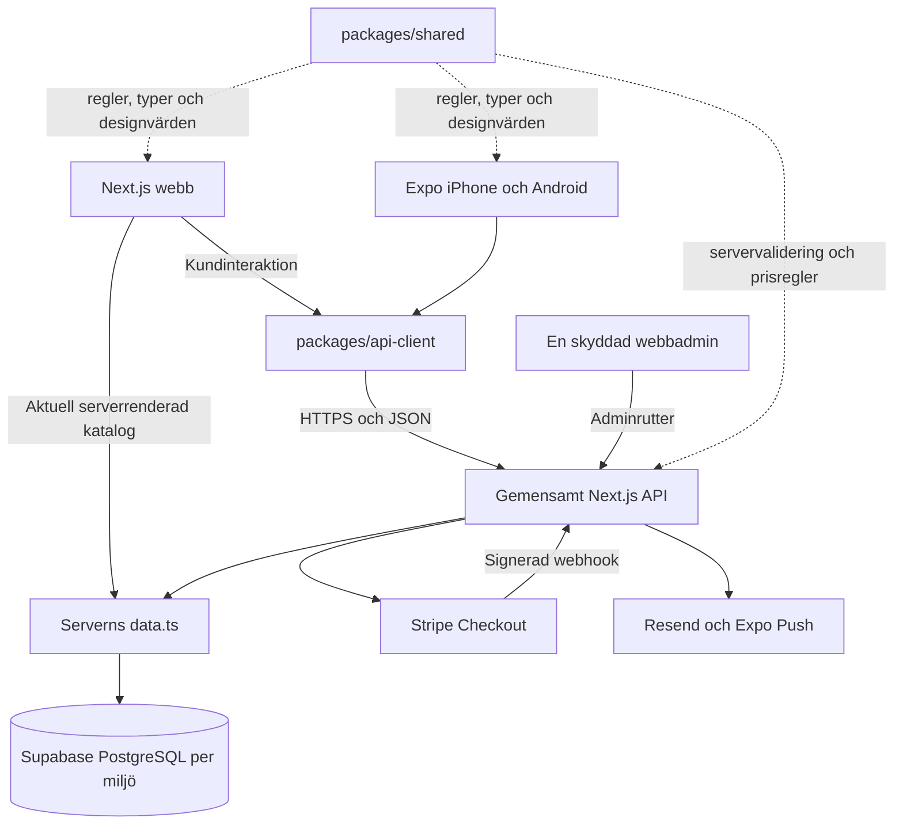

# Yehabibi V4.2 – ett gemensamt system

V4.2 förenklar den befintliga V4.1-plattformen. Next.js är fortfarande webbfrontend, gemensam backend och enda adminpanel. Expo är fortfarande kundappen för iPhone och Android. Båda använder samma data, orderformat och regler inom respektive miljö.

Ingen extra backend, databas, migration eller mobiladmin skapas. Befintliga kunduppgifter, katalog-ID:n, ordernummer och historiska priser bevaras. Företagets riktiga externa tjänster måste verifieras separat; fungerande lokal kod betyder inte att produktionen är aktiverad.

## 1. Före och efter

V4.1 hade redan en Next.js-backend, gemensamma ordertabeller och ett shared-paket för grundtyper, beräkningar och Zod. Problemet var återstående upprepning i kundgränssnitten och egna HTTP-anrop. [Nulägesrapporten](V4_1_NULAGE.md) dokumenterar källcommit, tidigare CI och beroendekartan som granskades före refaktoreringen.

| Område | Före: V4.1 | Efter: V4.2 |
| --- | --- | --- |
| Backend | Gemensam Next.js | Samma backend och rutter |
| Databas | Gemensam Supabase/PostgreSQL per miljö | Samma tabeller och migrationskedja |
| HTTP | Expo hade egen fetch/timeout; webb skickade egna anrop | `packages/api-client` för publika katalog-/orderanrop |
| Formulär/order | Vyer byggde delvis egna payloads och kontroller | Samma `buildOrderPayload`, detalj-/kontaktregler och schema |
| Pris/portioner | Gemensam grundberäkning men upprepade förhandsvisningar och portionsuttryck | Samma offert, minimiantal, portionsförslag och gränser |
| Demo | Separata förhandsvisningar i mobil/server | Samma `previewCatalog` med pris 0 och stängda beställningar |
| Kataloguppdatering | Ingen gemensam tydlig återkomststrategi | Fokus/online/knapp på webb; återkomst/drag på native |
| Status/design | Delvis skilda statussteg, färger och kategorinamn | Delat kundförlopp, betalregel, färger, kategorier och formulärsteg |
| UI | Befintliga HTML- och React Native-komponenter | Samma komponenter återanvänds inom respektive plattform |

Den logiska arkitekturen har **en backend och en gemensam databas per miljö**. Det är ingen uppgift om en verifierad aktiv produktionsdatabas: företagets konton och driftsättning redovisas i [PUBLICERING.md](PUBLICERING.md) och [TESTER.md](TESTER.md).

```text
YEHABIBI/
├── apps/
│   ├── web/                 Next.js webb, admin, API och serverintegrationer
│   └── mobile/              Expo skärmar och native funktioner
├── packages/
│   ├── shared/
│   │   ├── types/           Gemensamma kontrakt
│   │   ├── pricing/         Pengar, zoner, datum och statusövergångar
│   │   ├── ordering/        Matval, offert, payload och kundflöde
│   │   ├── validation/      Zod-scheman
│   │   ├── design/          Färger, kategorier och formulärsteg
│   │   ├── catalog/         Avstängd förhandsvisning
│   │   └── limits.ts        Gemensamma gränser
│   └── api-client/          Typade publika fetch-anrop
├── supabase/migrations/     Befintlig databas, ingen V4.2-migration
├── tests/
└── docs/
```

## 2. Så kommunicerar delarna



Webbens serverkomponenter läser direkt genom `data.ts`. Det behåller SSR, metadata, lokala landningssidor och SEO utan en HTTP-omväg till den egna servern. Serverrenderingen använder aktuella data i stället för en statiskt fryst katalog.

Efter första renderingen använder webbens kundvyer samma API-klient som Expo. API-klienten är liten TypeScript med vanlig fetch, ingen React-hook eller HTTP-bibliotek. Den stöder same-origin, plattformens basadress, timeout, avbrott och svenska felmeddelanden. `ApiError.kind` skiljer bland annat nätverksfel, timeout, HTTP-fel och ogiltiga svar. `status` bevaras vid exempelvis en prisrevision som ändrats.

## 3. Gemensamma filer och plattformarnas ansvar

| Gemensamt | Används till |
| --- | --- |
| `packages/shared/types/index.ts` | Katalog, `MenuSelection`, orderpayload, kvitto och privat orderstatus |
| `packages/shared/pricing/index.ts` | Öresberäkning, datum, leveranszoner, statusövergångar och kronor |
| `packages/shared/ordering/index.ts` | `quoteSelection`, `suggestedQuantity`, `minimumGuestsFor`, `buildOrderPayload`, formulärfel, utkast, betalval och kundens statussteg |
| `packages/shared/validation/index.ts` | Samma scheman i formulär och server |
| `packages/shared/design/index.ts` | Cedergrönt `#155A43`, rött `#B63842`, sand `#F7F5F2`, övriga färger, kategorinamn och stegnamn |
| `packages/shared/catalog/index.ts` | Samma tydligt avstängda demo, utan påhittade bokningsbara priser |
| `packages/api-client/index.ts` | Katalog, meny/inställningar, skapa order, status, prisacceptans och pushregistrering |

`apps/web/src/lib/api-client.ts` väljer same-origin. `apps/mobile/lib/api.ts` väljer `EXPO_PUBLIC_API_URL` och hanterar enhetens lagring, länkar och pushbehörighet. Inget av dessa gemensamma paket innehåller service-role, Stripe secret eller mejlnycklar.

Webbens DOM, formulärfält, routing, metadata och serverrendering stannar i Next.js. Mobilens navigation, tangentbord, systemdatumväljare, SecureStore och native push stannar i Expo. Vyerna behöver olika plattformsfunktioner men får samma regler och data.

Det finns inget nytt `packages/ui`. Webbens `ItemPicker` återanvänds i katalog och beställning. Mobilens `DishCard`, `Stepper`, `Amount` och `Screen` används av flera skärmar. Att tvinga dessa genom ett nytt renderingslager skulle öka komplexiteten utan att ta bort de viktiga regelskillnaderna; de delas redan genom shared.

## 4. Ett kundflöde från val till status

1. Kunden väljer cateringpaket eller egna rätter ur katalogen.
2. Samma regler beräknar pris, portionsförslag och minsta antal. Beloppen är hela öre; visat pris per person är en jämförelse, ingen uppdelad betalning.
3. Datum, plats, leveranszon och kontakt kontrolleras med gemensamma funktioner. Svenska datumregler använder Europe/Stockholm.
4. `buildOrderPayload` skapar samma format. Klienten skickar produkt-ID, mängder och kunduppgifter, inga auktoritativa klientpriser.
5. Gränssnittet låser dubbeltryck och skickar `request_id` genom `createOrder` till `/api/orders`.
6. Servern validerar igen, läser aktuella priser/zoner och låter `create_catering_order` spara order och rader i en SQL-transaktion.
7. Kvittot innehåller orderkod, privat token och statuslänk. Ordern är mottagen, ännu inte godkänd eller betald.
8. Ägaren granskar i samma webbadmin oavsett vilken plattform kunden använde.
9. Ett nytt pris kräver uttrycklig kundacceptans av rätt revision. Originalraderna bevaras; godkänd prisjustering visas separat.
10. Godkänd onlineorder får Checkout från servern. Bara verifierad webhook sätter betald status. Kunden följer samma serverbekräftade orderstatus på båda plattformar.

API-klientens `getMenu` och `getSettings` läser ur samma `/api/catalog`. `getOrderStatus` läser `/api/orders/[code]?token=...`; `acceptPriceChange` och pushregistrering använder PATCH där. En ny checkout-route behövs inte: den aktuella tillåtna länken finns i serverns `PublicOrder`.

## 5. När ägaren ändrar en maträtt

Ägaren sparar pris, bild, kategori eller aktivering genom den skyddade adminpanelen. Ändringen skrivs i samma `dishes`/`menus` och läses av `data.ts` och `/api/catalog`.

| Plattform | När den hämtar aktuell katalog |
| --- | --- |
| Webb | Aktuell serverrendering; kundvyer uppdaterar vid fokus, synlig flik, online och knappen Uppdatera menyn |
| iPhone/Android | Vid start, när appen åter blir aktiv och när kunden drar för att uppdatera |

HTTP-klienten använder `cache: 'no-store'`. Det finns ingen separat handunderhållen liveproduktlista i mobilen. Menyförändringar blir synliga vid nästa hämtning; ingen realtidsprenumeration införs.

En verifierad hämtning rensar avpublicerade matval. Demo eller nätverksfel raderar inte ett sparat utkast. Ett katalogfel behåller vyn och matvalen men stänger beställning tills aktuella uppgifter kan hämtas igen. Gamla order läses från frysta orderrader och räknas aldrig om från den nya katalogen.

## 6. Utkast och återförsök

Utkast sparar matval och gästantal, inga kontaktuppgifter eller katalogpriser. Webbens adapter behåller sitt sessionStorage-/URL-format. Native använder SecureStore; Expo Web använder localStorage för matval. Privata orderreferenser sparas separat och behandlas som behörighetsuppgifter.

Klienterna sparar endast fingerprint och UUID för samma förfrågan, inte kontakttexten. Ett identiskt återförsök återanvänder nyckeln. Webbens nyckel byts inte bara för att 24 timmar passerat medan en förfrågan är olöst; menyutkastets egen livslängd är separat. Mobilen behåller nyckeln efter omstart när lagringen fungerar.

Servern jämför innehållets HMAC och databasen låser per `request_id`. Samma nyckel/innehåll ger samma order, även vid samtidiga återförsök eller efter en senare katalogändring. Ändrat innehåll med samma nyckel ger konflikt. Detta skydd kompletterar gränssnittets dubbeltrycksspärr.

## 7. Betalningar och databasbehörighet

Ett enda betalningssystem finns i `apps/web/src/lib/payments.ts`, `checkout.ts` och webhook-rutten. Kort och stödd Apple Pay går genom Stripe Checkout. Swish visas endast när servern tillåter den verifierade metoden. Kontant erbjuds bara vid hämtning när företaget tillåter det.

Webhooken kontrollerar signatur, order, session, valuta och belopp. SQL tillämpar händelsen atomärt och hindrar dubbla betalningsuppdateringar. Frontendens återkomst från Checkout är inget betalningsbevis. Externa tjänster och livebetalningar aktiveras inte av denna ändring.

RLS och indragna publika rättigheter skyddar kunddata. API:t verifierar Supabase-admin med bekräftad e-post och allowlist. Privat kundåtkomst kräver kod och token. V2:s `menu_items` är en kompatibilitetsvy mot samma rätter, ingen andra katalog. Läs [DATABAS.md](DATABAS.md) och [BETALNINGAR.md](BETALNINGAR.md).

## 8. Starta och utveckla i Windows

Kör från repots rot med Node.js 22.13 eller senare:

```powershell
npm ci
if (!(Test-Path apps/web/.env.local)) {
  Copy-Item apps/web/.env.example apps/web/.env.local
}
if (!(Test-Path apps/mobile/.env.local)) {
  Copy-Item apps/mobile/.env.example apps/mobile/.env.local
}
```

Starta `npm run dev` i första terminalen och `npm run dev:mobile` i den andra. Fysisk mobil på samma Wi-Fi använder datorns LAN-IP i `EXPO_PUBLIC_API_URL`; Android-emulator använder `http://10.0.2.2:3000`. Publicerad app kräver HTTPS. Starta om Expo efter ändring av API-adressen. [EXPO.md](EXPO.md) beskriver EAS och native förutsättningar.

| Ändring | Börja här |
| --- | --- |
| Pris, minimiantal, datum, portionsförslag eller statusregel | `packages/shared`, sedan relevant beteendetest |
| Nytt orderfält | Shared-typ/schema/payload, serverns lagring och båda formulären |
| Publikt HTTP-anrop eller gemensamt fel | `packages/api-client` och `tests/api-client.test.mjs` |
| Native tangentbord, datum eller pushbehörighet | `apps/mobile/lib/ui.tsx` eller `lib/api.ts` |
| HTML, SEO eller webbadmin | `apps/web/src` |
| Riktiga produkter, priser, media eller leveranszoner | Befintliga adminpanelen och databasen |

Servern fortsätter vara auktoritativ även när en regel delas med frontend. Flytta inte tjänstenycklar till shared för att förenkla ett klientanrop.

## 9. Verifiering och publicering

```powershell
npm run syntax
npm test
npm run typecheck
npm run build
npm run test:web
npm run export:mobile
npm run test:integration
```

Det sista kommandot kräver de isolerade PostgreSQL/PostgREST-verktygen enligt [TESTER.md](TESTER.md). Testsviten omfattar gemensamma regler/kontrakt, katalogändringar, historiska priser, dubbelbeställningsskydd, prisacceptans, betalningsavstämning och nätverksfel. Läs TESTER för faktiskt körda kommandon och resultat; detta dokument är ingen egen verifieringsrapport.

En export för Android/iOS/webb bevisar paketeringen. Fysisk iPhone/Android, ett nytt EAS-nativebygge, Stripe/Swish/Apple Pay, levererad Resend-e-post och APNs/FCM behöver egna kontroller. Företagsuppgifter, godkända produkter, juridiskt innehåll och separata miljöuppgifter återstår när de externa tjänsterna inte är verifierade.

GitHub-main är källan för Sites-synk. `scripts/sync-sites.mjs` kopierar granskad källkod och shared/API-paketen till det befintliga Sites-projektet och bevarar dess Worker/Vinext-bygglager och identitet. Skriptet publicerar inte självt. [PUBLICERING.md](PUBLICERING.md) redovisar senaste verifierade SHA, CI och faktisk Sites-status. Ingen publicering räknas som lyckad utan kontroll.
